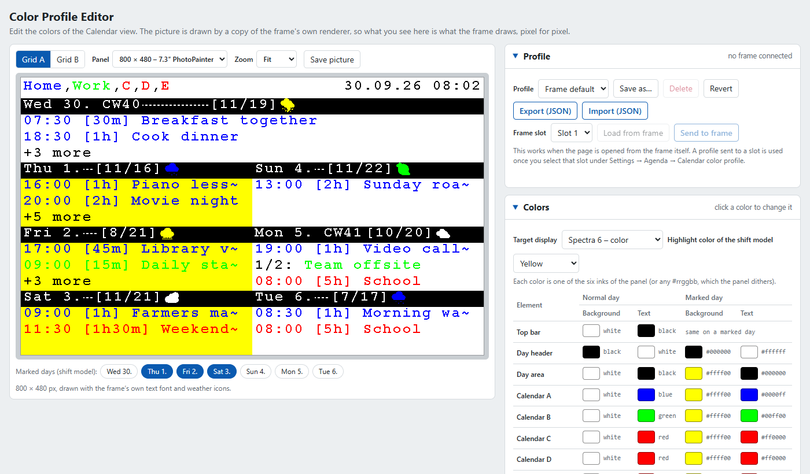

# The colour profile editor

The Calendar view (`agenda` option) takes its colours from a **colour profile**: the colours of the top bar, the day headers, the day
areas, the five calendars and the weather icon box, plus a few switches. The editor is a page of its own that lets you build such a
profile and see the result before the frame draws it.

## Open it

- On the frame: **Settings > Agenda > Calendar color profiles > Open Color Profile Editor**, or `http://<frame>/profile-editor.html`.
  Opened from the frame, the page can also load profiles from the frame's slots, send a profile to a slot and read the frame's Calendar
  settings.
- Without a frame: the page is one file and works from a download too (save it from the address above, or take `webapp/public/profile-editor.html`
  of this repository). Then it only exports and imports JSON files.

## The picture is the frame's picture

The preview is not a look-alike. It is drawn by a copy of the frame's own Agenda renderer - the same 17 x 24 pixel text font, the same weather
icons, the same cells, dashes, truncation (`~`) and "+3 more" - so it shows what the frame draws, pixel for pixel. Checked three ways:

- The tests draw 88 pictures (grid A and B, marked days, priority, week numbers, weather on the right, the temperature and humidity chips, seven profiles with filled and unfilled header gaps, five panel sizes) with the copy and compare
  each with the picture the real `agenda_renderer.c` draws: identical (`webapp/src/utils/agendaEngine.test.js`).
- A frame's own picture (`/api/current_image`), compared with the copy using that frame's settings and colour profile: the edges, the header
  bars, the marked days, the text rows and all seven day labels are identical.
- The page ships the copy inside itself (`scripts/sync_profile_editor.py`), and a test draws with that copy too.

What it does **not** draw: the list layout (1-3 days) of the Calendar view; grid A and grid B are drawn. The panel's six inks are shown as
pure colours; a colour that is not one of the six (a `#rrggbb` of your own) is **dithered** by a Spectra 6 panel and the editor warns about
it (a `⚠` next to the colour, and a line under the picture).

## Using it

**Under the picture** - the layout (grid A or B), the panel size (7.3" 800 x 480, 480 x 800, 960 x 540, 13.3" 1600 x 1200 and 1200 x 1600),
the zoom (fit, 100 %, 200 %) and **Save picture** (a PNG). The seven day buttons switch days on and off as *marked*: the days the shift
model highlights. Switch some on to see the highlight colours.

**Colors** - one row per element, the *normal day* colours on the left and the *marked day* colours on the right. Click a colour to choose
one of the six inks (or any other colour). The marked-day colours are worked out by the same code the frame uses, so you cannot edit them
except the weather icon box, which has a colour of its own for marked days. If one of the switches below changes the colour you set, the
table says what is **shown** instead. *Target display* chooses colour (Spectra 6) or monochrome; on a monochrome panel the frame draws black
and white only and the colours are kept but ignored. *Highlight color* is the colour of the shift model.

**Header and highlight options** - the six switches of the profile, each with a line that says what it does. A switch that has no effect with
the current settings is greyed out (for example the colour-panel switches when the target is monochrome).

**Sample content** - what the preview draws: the date, language, week numbers, how times are shown, multi-day events, the order and priority
of the calendars, the weather (the forecast of each day, the icon set, coloured icons, left or right), the temperature and humidity in the top
bar, the names of calendars A and B, and a list of events you can change, add to and remove. It is not part of the profile. **Match my
frame's settings** reads the Calendar settings from the frame (layout, weather, language, order, priority, calendar names) so the preview
follows your frame.

**Profile** - the list holds three starting points (*Normal*, *Inverted*, *Frame default* - the profile built into the firmware) and the
profiles you saved. **Save as...** keeps the colours on screen under a name (in this browser), **Revert** throws away the changes,
**Export** and **Import** move a profile as a JSON file. **Load from frame** reads a slot; **Send to frame** writes the profile into a slot (three
slots). The frame uses a slot once you select it under *Settings > Agenda > Calendar color profile*; the slot list marks the one in use.

## Good to know

- The profile is the same JSON as before (`type: spectra6-firmware-profile`): 16 colours, the optional icon box colours, the mode, the
  highlight colour and the six switches. Profiles exported by earlier versions of the editor import without change.
- What you did before is kept: the editor remembers its state in the browser, and an older state is read and cleaned on load.
- The page works without internet access and has no dependencies; everything is in the one file.

For maintainers: how the copy of the renderer is made, tested and kept in step with the firmware is in [MAINTAINING.md](MAINTAINING.md)
(the colour profile editor, section 17 file map and the pitfall table).
