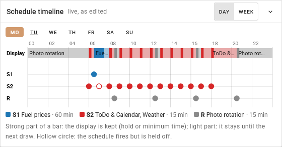
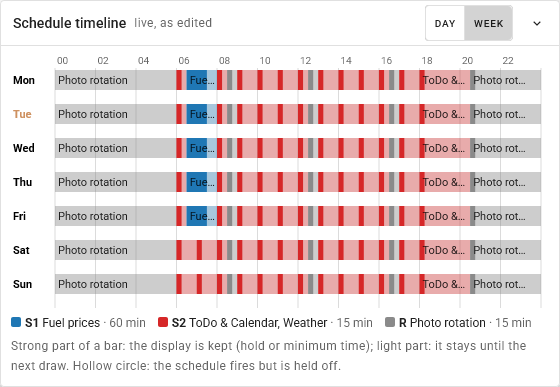

# Pages per schedule

> **Build option:** compiled in only with `python build.py --with schedule-pages` (needs `info-screens`; the build pulls it in), part of the
> `extras` bundle and of every full build. Without it the firmware is the upstream firmware (see [FEATURES.md](FEATURES.md)).
>
> **Status:** host-tested (also against a literal reference over random schedules and across the days the clock changes) and checked on a **USB-powered** Waveshare frame with schedules a few
> minutes apart. **Not seen yet:** the deep-sleep wake of a battery frame, which uses the same functions - please report what you see.

The [information screens](INFO_SCREENS.md) take turns on the Agenda's schedule: every time the schedule fires, the next page of the
rotation is drawn. With this option **each schedule of the Agenda can draw its own pages**, so that a schedule at 06:30 can always show
the fuel page and the hourly one the Agenda. When schedules overlap, the one with the smaller number wins, and a display is never replaced
by another within a minimum time.

**It is optional per schedule.** A schedule with no page ticked behaves exactly as before: it draws the next page of the shared rotation
(Settings -> Agenda -> Information screens). And while **no** schedule has a page ticked, nothing of this option is in force - not the
priorities, not the minimum time - the frame behaves as without the option.

**A schedule may only draw a page that is also available right now.** For ToDo & Calendar that means ToDo or Calendar itself is
on (it has no tick of its own under Information screens - see [INFO_SCREENS.md](INFO_SCREENS.md)); for every other page it means
being ticked under Information screens. The two lists are kept in step on purpose: a page a schedule was given, then made
unavailable this way, stops being drawn by that schedule instead of continuing to show on its old assignment while looking "off"
everywhere else - making it available again brings it straight back (the Web UI keeps the schedule's chip ticked, only greyed
out, while this is the case). A schedule whose available pages have all become unavailable draws the shared rotation instead,
exactly like a schedule with no pages ticked at all; if every schedule is in that state (or every schedule was simply given no
pages, or the option isn't in force to begin with), the frame does not even wake for it - see the next paragraph.

**A page a schedule holds onto, with nothing left to make it effective, does not wake the frame either.** Being given pages at
some point is not the same as those pages being usable right now: with ToDo, Calendar and every information screen off, a
schedule whose only page is ToDo & Calendar - or whose pages have all since been unticked under Information screens, or made
unavailable by ToDo and Calendar both being switched off - would find nothing to draw at its next fire. The frame checks for this
before waking, not after, so a forgotten assignment of this kind
costs nothing (no wake, no log entry, nothing - as opposed to waking, discovering there is nothing to draw, and going back to
sleep, which it used to do).

**A page that is on but assigned to no schedule is never drawn once every schedule has pages of its own**, because then nothing
is left to fall back to the shared rotation (the previous paragraphs) for it to take a turn in. The Web UI warns about this under
the Schedule section, naming the page; add it to a schedule, or clear one schedule's own pages so the shared rotation covers it
again.

## Settings

Settings -> **Agenda** -> Schedule. Under each schedule card:

| Setting | Default | What it does |
| --- | --- | --- |
| Pages this schedule draws | none | The pages of this firmware as chips (ToDo & Calendar, chore wheel, weather, fact of the day, exchange rates, fuel prices, markets). None ticked: the shared rotation. Several ticked: they take turns on this schedule, with a rotation counter of its own. A chip is greyed out (and its tick is kept, not cleared) while that page is not available: ToDo & Calendar while neither is switched on above, every other page while it is not ticked under Information screens below |
| Keep this display at least (minutes) | 0 | The **hold time** of this schedule: how long its display should stay before another one may replace it. 0: the common minimum time below |
| Up / down arrows | - | Move the schedule: **the order is the priority**, Schedule 1 is the highest |
| Minimum time between two displays | 15 | The common minimum time, 0-240 minutes. 0 resolves only schedules that fire in the same minute |

A schedule card can hold several fire times; the Web UI gives all of its rules the card's pages and hold. (After saving and reloading, every
rule shows as a schedule of its own, which is how the frame has always listed them; each keeps the pages and the hold.)

## The timeline

While you edit the schedules, a small window floats at the bottom right of **Settings -> Auto Rotate** and **Settings -> Agenda** (and
only there). It draws what the frame will do with the settings **as they stand in the editor, saved or not** - every change shows at once -
by the rules below:

- **Display** (the strip on top): what is on the display, hour by hour. Every schedule has a colour (`S1`, `S2`, ... as numbered in the editor, grey:
  the photo rotation). The **strong part** of a bar is the time the display is kept (the schedule's own hold, or the minimum time between two
  displays); the **light part** runs until the next draw. The strip starts with what the day before left on the display.
- **One row per schedule** (day view): every fire of it. A **filled circle** is drawn, a **hollow circle** fires but is held off (in the picture the
  07:00 Agenda, because the 06:30 page is kept until 07:30). Hover over a bar or a circle for the time, the page and until when.
- **Day / Week**: the day view has the buttons Mo..Su (today is underlined, a red line marks now); the week view shows the display strip of all
  seven days, Monday to Sunday.

The window can be **dragged** by its title (a double click puts it back), **minimized** with the arrow (it becomes a small *Timeline* button) and
remembers its place and view in this browser. On a narrow screen it is a sheet at the bottom that starts minimized.

What it does not show: times are the frame's wall-clock times in a plain week (no daylight saving changes); the alarm clock is not part of it (it
never draws); a card with several fire times of different minutes is stored as several rules, so it shows as several schedules (`S1`, `S2`, ...),
each with the card's pages and hold; and the Agenda's schedules only show while the Agenda is on (ToDo, Calendar, a ticked information screen or a
schedule with a page). While no schedule has a page of its own the window says so: then there is no minimum time and only the same minute is
resolved.

The decision is the firmware's own: `webapp/src/utils/schedPick.js` is a port of `main/sched_pick.c`, and `schedPick.test.js` compares it with the
C code on 48 schedule sets over a week (`scripts/gen_sched_fixtures.py` collects the answers into `schedPick.fixtures.json`; run it again when
`main/sched_pick.c` or `main/cron.c` changes).

## The rules

Schedule 1 has the highest priority, then 2, and so on. The **photo rotation** (Auto Rotate's own schedule) has the lowest. A fire of
schedule *k* at a minute *t* is **drawn** unless a schedule with a smaller number draws

- **within its hold before it** (a display that has just been drawn is left alone for its hold time; the same minute always counts), or
- **within the hold of *k* after it** (the display of *k* would be replaced before its hold has passed, so it is skipped from the start).

Further:

- Only fires that are drawn count. A fire that is held off does not hold off a lower one: with schedules at 06:00, 06:10 and 06:20 and a minimum
  time of 15 minutes, the second one is held off by the first, and the third (20 minutes after the first) is drawn.
- A schedule never holds off itself: a schedule that fires every 10 minutes is drawn every 10 minutes whatever the minimum time is.
- At most one schedule draws in a minute.
- A skipped fire does **not** wake the frame, draws nothing, fetches nothing and does not move a rotation counter. The next wake is the next
  fire that is drawn.
- A deep-sleep wake that lands up to 5 seconds *before* the minute of a schedule counts as that minute (the same tolerance `main.c` gives the photo rotation); a wake earlier than that goes back to sleep for the rest. A wake lands a few seconds off its minute in either direction, and without this tolerance the schedule was not recognised and the wake ran as a photo rotation (`main/wake_minute.h`).
- The existing rule stays: in the same minute the **alarm** comes first, then the Agenda schedules, then the photo rotation. Beyond that
  the photo rotation also gives way within the minimum time: a rotation shortly before or after an Agenda display is skipped.

### Example: the commute page

| Schedule | Fires | Pages | Hold |
| --- | --- | --- | --- |
| 1 | 06:30 on weekdays | fuel prices | 60 |
| 2 | every hour from 06:00 to 18:00 | Agenda, weather | 0 (the common 15) |

The 06:00 Agenda is drawn (schedule 1 comes 30 minutes later, more than the 15 minutes this display needs). The 06:30 page is drawn and stays
until 07:30: the 07:00 Agenda is held off. The Agenda comes back at 08:00.

## Settings in the API

`GET/PATCH /api/config`: `agenda_cron` (the rules, in priority order) together with `agenda_cron_pages` (a list of page-name lists, one per
rule; an empty list: the shared rotation), `agenda_cron_hold` (minutes per rule) and `agenda_gap_min`. Page names are those of
`info_screens` (`agenda`, `chore-wheel`, `weather`, `fact`, `finance`, `fuel`, `markets`). A client that reorders or removes rules sends the
three lists together with `agenda_cron`; the lists belong to the rules by position.

## How it works, and how it was checked

`main/sched_pick.c` is pure C (host-tested in `host_tests/test_sched_pick.cpp`): it decides which schedule draws in a minute and when the next
drawn fire is. The tests include a comparison with a reference that follows the definition literally, over random schedule sets, also on the
days the clock changes. `agenda_manager.c` uses it for the decision at a wake, for the time to the next wake (so a held-off fire does not wake the
frame) and for the page of a run; `get_seconds_until_next_wakeup()` uses it for the photo rotation. Per schedule the frame stores the page
mask, the hold and the rotation counter (settings memory).
