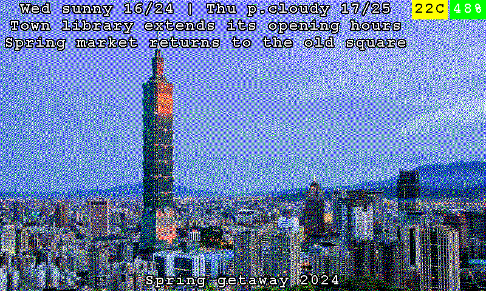
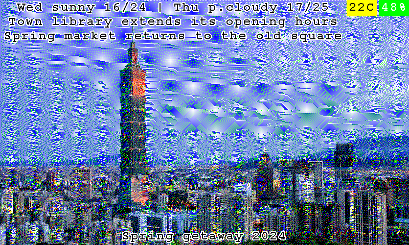
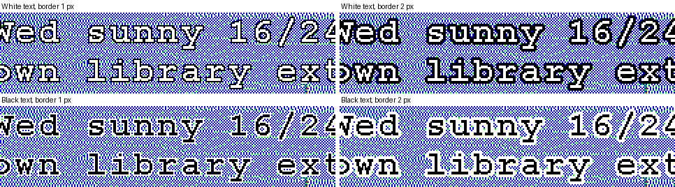
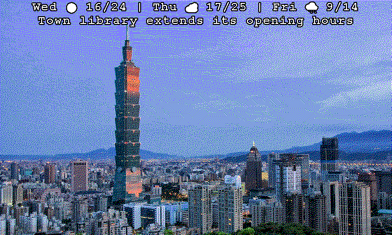

# Overlay and caption text with a border instead of a bar

> **Build option:** compiled in only with `python build.py --with text-outline` (needs `overlays`; the build pulls it in; part
> of the `extras` bundle); without it the firmware is the upstream firmware (see [FEATURES.md](FEATURES.md)). The default is
> still the bar: nothing changes until you choose a text style.

The weather and headline overlays and the captions are drawn as a black (or, inverted, white) **bar** across the picture, with
the text on it ([OVERLAYS.md](OVERLAYS.md)). A bar always hides a strip of the photo. With this option the text can be drawn
**alone**, with a border that keeps it readable on a light or a dark picture:

| Style | Text | Border |
| --- | --- | --- |
| **Bar** (default) | white (black when inverted) | - (the bar is the background) |
| **White text, black border** | white | black |
| **Black text, white border** | black | white |

The border is **1 or 2 pixels** wide; 2 pixels read better on a busy picture. The letters stand exactly where they stand on the
bar - the same lines, the same centring, the same cut-off with `...` or `~` - only the bar is missing.

*Sample data, drawn by the firmware's own code - [more pictures](SCREENSHOTS.md).*

The four borders, enlarged:

## Settings

**Settings -> Overlays -> Text style:**

- **Overlay text style**: the bar (default), white text with a black border, or black text with a white border.
- **Border width**: 1 or 2 pixels (2 by default; greyed out while the bar is chosen).
- With a text style the **invert switch** does not apply - the style chooses the colours.
- The checkbox **Also apply color inversion and text style to Telegram and photo-date captions** (the old "also apply color inversion
  to Telegram photo captions") now also decides whether the captions follow the style. It is off by default, so a caption keeps its
  bar until you tick it, exactly as with the inversion.

## What follows the style and what does not

| | Follows the style |
| --- | --- |
| The weather and headline lines at the top | always |
| The Telegram caption and the capture-date caption at the bottom | only with the checkbox above |
| **Weather icons** in the weather line | yes - they get the same border as the letters, in the border's colour (an icon with its own traffic-light colour keeps that colour inside the border) |
| The low-battery badge and the climate badges | no - they are small coloured boxes, and the colour is the message |
| The error banner (a message when WiFi or the internet fails) | no - it is a warning and keeps its bar |
| The caption of the `artworks` mode | no - it already has its own white text with a one pixel black border |

## API

`GET /api/config` returns, and `PATCH /api/config` takes:

| Field | Values | Meaning |
| --- | --- | --- |
| `overlay_text_style` | `"bar"` (default), `"white"`, `"black"` | the style: `white` is white text with a black border, `black` is black text with a white border. Any other value is ignored |
| `overlay_text_border` | `1`, `2` (default `2`) | the width of the border in pixels; a number outside is brought to 1..2 |

Both are saved in the frame's settings (NVS keys `ovl_txt_style`, `ovl_txt_bord`). `caption_invert_colors_enabled` decides about the
captions, as before.

## How it works

`image_processor.c` draws the text of an overlay or a caption block with `render_text_bar()`; with a text style the same lines are
drawn by `render_text_outlined()` instead: first every letter and icon in the **border colour** at each offset of the border, then
once in the **ink colour**. The offsets of one pixel are the eight neighbours, those of two pixels the 5 x 5 square without its four
corners, which keeps the corners of the border round (`text_outline.c`, with the names, the clamping and a unit test of each). The
borders of all lines are drawn before any ink, so the border of one letter never covers the next letter. Only the display palette's
exact black and white are used, so the picture stays a valid "processed" image. An icon's border is the icon's own shape drawn
at the same offsets.

The look is chosen where the text is drawn: the overlay lines read the settings themselves, the captions through
`image_processor_draw_caption_look()` and `image_processor_add_caption_look_to_file()` (used by the Telegram bot and the capture-date
caption); the plain `image_processor_draw_caption()` and `_draw_overlay_bar()` are always the bar, so the error banner and every
other caller keep the look they had.

## Notes

- Without a bar the text has nothing under it but the photo. On a very busy or mid-grey picture a bar is still the safest
  choice; 2 pixels help most.
- The border makes the text look about 4 pixels bigger in every direction (2 on each side). The lines keep their 4 pixel padding, so
  the border never leaves the picture.
- Checked by 17 host tests ([host_tests/test_text_outline.cpp](../host_tests/test_text_outline.cpp)): the helpers, the real drawing
  (letters where the bar has them, a border around every ink pixel for both widths, the colours swapped between the two styles,
  an icon's border, nothing outside the picture, the plain functions unchanged) and the overlay and caption path through a PNG file.
